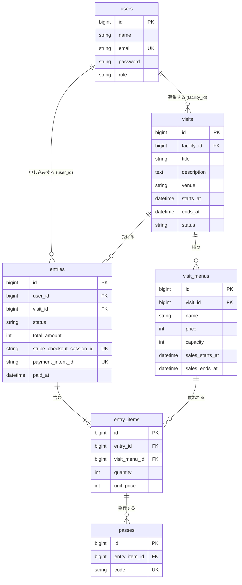

# データベース設計

仕様書（[01_requirements.md](../spec/01_requirements.md)）のコア機能を実現するためのテーブル設計。  
`users` は既存のテーブルに `role` を追加する。新規は `visits` / `visit_menus` / `entries` / `entry_items` / `passes` の5つ。

## ER 図



## カラム定義

全テーブルに `id`（bigint, PK）と `created_at` / `updated_at` がある。以下では省略する。

### users（既存に追加）

| カラム | 型 | 制約 | 説明 |
|-|-|-|-|
| role | string | not null, default `visitor` | `visitor` / `facility` / `admin`。PHP の Enum にキャストする |

### visits

| カラム | 型 | 制約 | 説明 |
|-|-|-|-|
| facility_id | bigint | not null, FK → users.id | 福祉施設 |
| title | string | not null | 慰問名 |
| description | text | not null | 説明 |
| venue | string | not null | 会場 |
| starts_at | datetime | not null, index | 開催日時。一覧の並び順と「開催済みを除く」に使う |
| ends_at | datetime | not null | 終了日時。`starts_at` より後 |
| status | string | not null, default `draft` | `draft`（下書き） / `published`（公開中） / `unpublished`（管理者が非公開にした状態。福祉施設は戻せない） |

### visit_menus

| カラム | 型 | 制約 | 説明 |
|-|-|-|-|
| visit_id | bigint | not null, FK → visits.id | 所属する慰問 |
| name | string | not null | メニュー名（一般、学生 など） |
| price | unsigned int | not null | 価格（円） |
| capacity | unsigned int | not null | 定員 |
| sales_starts_at | datetime | not null | 販売開始 |
| sales_ends_at | datetime | not null | 販売終了 |

### entries

| カラム | 型 | 制約 | 説明 |
|-|-|-|-|
| user_id | bigint | not null, FK → users.id | 申し込み者 |
| visit_id | bigint | not null, FK → visits.id | 対象慰問。1申し込みは1慰問に限る |
| status | string | not null, default `pending`, index | `pending`（支払い待ち） / `paid`（支払い済み） / `cancelled`（キャンセル） / `refunded`（返金済み）。PHP の Enum（`EntryStatus`）にキャストする |
| total_amount | unsigned int | not null | 合計金額（円）。明細の `unit_price × quantity` の合計 |
| stripe_checkout_session_id | string | nullable, unique | Checkout Session の ID。Stripe へ進むまでは null |
| payment_intent_id | string | nullable, unique | 支払い済みにしたときの PaymentIntent の ID。返金（E3）で申し込みを特定するために保存する。無料の申し込みは null |
| paid_at | datetime | nullable | 支払いが確定した日時 |

### entry_items

| カラム | 型 | 制約 | 説明 |
|-|-|-|-|
| entry_id | bigint | not null, FK → entries.id | 所属する申し込み |
| visit_menu_id | bigint | not null, FK → visit_menus.id | 買ったメニュー |
| quantity | unsigned int | not null | 人数 |
| unit_price | unsigned int | not null | 申し込み時点の単価（円）。あとでメニューの価格が変わっても申し込みは変わらない |

`(entry_id, visit_menu_id)` に unique を付け、同じメニューは1行にまとめる。

### passes

| カラム | 型 | 制約 | 説明 |
|-|-|-|-|
| entry_item_id | bigint | not null, FK → entry_items.id | どの明細から発行されたか。申し込みとメニューはここから辿る |
| code | string | not null, unique | 1名ごとの固有コード（UUID） |

支払い済みになったとき、明細の `quantity` の人数分を発行する。

## 外部キーの削除時の動き

お金に関わる記録は restrict、親と一体のものは cascade とする。

| 外部キー | 動き | 理由 |
|-|-|-|
| visits.facility_id → users | restrict | 慰問を残したまま福祉施設が消えるのを防ぐ |
| visit_menus.visit_id → visits | cascade | メニューは慰問の一部 |
| entries.user_id → users | restrict | 申し込みの記録を消さない |
| entries.visit_id → visits | restrict | 申し込みがある慰問は削除できない |
| entry_items.entry_id → entries | cascade | 明細は申し込みの一部 |
| entry_items.visit_menu_id → visit_menus | restrict | 売れたメニューは削除できない |
| passes.entry_item_id → entry_items | cascade | 参加証は明細の一部 |

申し込みが1件でもある慰問やメニューは削除できない。画面側では、DB エラーになる前にポリシーかバリデーションで「申し込みがあるため削除できません」と表示する。

## 残り人数の計算

残り人数はカラムに持たず、メニューごとに申し込み明細から毎回計算する。

```
残り人数 = capacity − 支払い済みの人数 − 有効な支払い待ちの人数
```

| 項目 | 数え方 |
|-|-|
| 支払い済みの人数 | そのメニューの `entry_items.quantity` のうち、申し込みが `paid` のものの合計 |
| 有効な支払い待ちの人数 | そのメニューの `entry_items.quantity` のうち、申し込みが `pending` かつ `entries.created_at` が15分以内のものの合計 |

- `cancelled` と `refunded` の申し込みは数えない（枠が戻る）
- 計算結果が 0 未満になる場合は 0 として表示する
- 15分を過ぎた支払い待ちの申し込みは数えない。放置された申し込みが枠を占有し続けないようにするため。時間は `EntryService::PENDING_MINUTES` で持つ

### 計算例

定員 50 のメニューに、次の申し込み明細がある場合。

| 申し込みの状態 | 作成からの時間 | 人数 | 数えるか |
|-|-|-:|-|
| paid | ─ | 30 | 数える |
| pending | 10分 | 5 | 数える |
| pending | 2時間 | 4 | 数えない |

残り人数 = 50 − 30 − 5 = 15

### 申し込み時のチェック（C9）

申し込みを作る前に、`EntryService::createEntry()` がメニューごとに次の3つを確認する。満たさないときは申し込みを作らず `PurchaseException` を投げ、画面はそのメッセージを表示する。

- 現在時刻が `sales_starts_at` 以上、`sales_ends_at` 以下である
- 申し込みする人数が残り人数以下である
- 申し込みする人数が 1 以上 `EntryService::MAX_QUANTITY`（10）以下である

このほか、慰問が公開中でないとき、メニューがその慰問のものでないときも申し込みを作らない。

同時に申し込みされた場合の競合（確認と申し込み作成の間に他の人が買う）はコアでは扱わない。拡張 E2 でトランザクションと行ロックを入れる。

## 未決定の点

- 支払い待ちの保持時間と Stripe の期限: 枠を押さえるのは15分だが、Stripe Checkout Session の有効期限は最短でも30分。15分を過ぎて枠が他の人に渡ったあとに元の申し込みが支払われると、定員を超える。決済を作るときに扱いを決める
- アカウント削除との衝突: スターターキットのアカウント削除機能は、申し込みや慰問を持つユーザーだと restrict により DB エラーになる。削除前にチェックして断る処理が必要
- `entries.visit_id` は明細から辿れるので冗長だが、福祉施設の申し込み一覧と売上（C16）を簡単にするために持つ
- コアの範囲外のため、慰問画像（E14）と参加証の使用日時（E1）は入れていない
