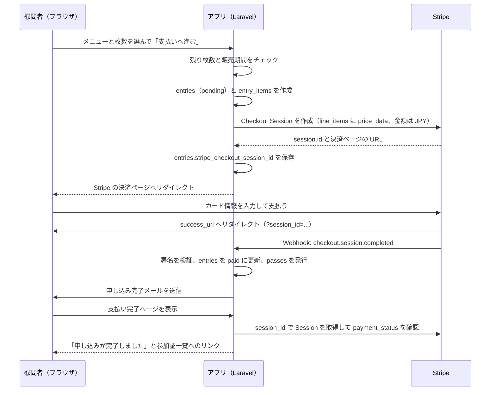

# 仕様書 4: 決済とメールの流れ、テスト、初期データ

> 平日課題（08〜11 章）で使います。

## 申し込みの流れ

 

## Stripe の実装方針

- `stripe/stripe-php` を直接使う。Cashier は使わない（1回払いだけなので、Cashier の顧客・サブスクリプションの概念が不要）
- Checkout Session は `mode = payment`、`line_items` に `price_data`（`currency = jpy`、`unit_amount = 単価`、`product_data.name = 慰問名 メニュー名`）を指定する。Stripe 側に商品を事前登録しない
- `metadata.entry_id` に申し込み ID を入れておき、Webhook で申し込みを特定する
- `success_url` は `/entries/{entry}/complete?session_id={CHECKOUT_SESSION_ID}`、`cancel_url` は `/entries/{entry}/cancel`
- Webhook は `POST /stripe/webhook`。CSRF の除外対象にし、`Webhook::constructEvent()` で署名を検証する
- 扱う慰問はコアでは `checkout.session.completed` のみ。拡張 E3 で `charge.refunded` を追加
- Webhook と完了ページのどちらが先に来ても壊れないように、`paid` への更新は「`pending` のときだけ更新する」条件付き更新にする
- 合計 0 円（無料券だけ）の申し込みは Stripe を通さず、その場で `paid` にする

### 環境変数

| 変数 | 内容 | 開発 | 本番 |
|-|-|-|-|
| `STRIPE_KEY` | 公開可能キー（`pk_test_...` / `pk_live_...`） | テスト | 本番 |
| `STRIPE_SECRET` | シークレットキー（`sk_test_...` / `sk_live_...`） | テスト | 本番 |
| `STRIPE_WEBHOOK_SECRET` | Webhook の署名シークレット（`whsec_...`） | Stripe CLI が発行 | ダッシュボードで登録して取得 |

### 開発環境での Webhook

- Stripe CLI の `stripe listen --forward-to localhost/stripe/webhook` でローカルに転送する
- CLI を入れない場合は、完了ページ側の確認（`payment_status` の取得）だけでも動作する。Webhook は Day5 の本番公開後に確認する

 

## メール

| メール | 送信タイミング | 宛先 | 内容 |
|-|-|-|-|
| 申し込み完了 | 申し込みが `paid` になったとき | 申し込み者 | 慰問名、日時、会場、メニューと枚数、合計金額、申し込み詳細への URL |

- Mailable（または Notification）1つ。Markdown メールテンプレート
- 開発は Mailpit（`http://localhost:8025`）で確認する
- 本番のメール API は1つに固定する（Resend などの無料枠）。`.env` の `MAIL_MAILER` と API キーだけを変える
- キューは使わない（拡張 E6 で導入）

 

## Pest テスト（コア C18）

| # | テスト | 確認すること |
|:-:|-|-|
| T1 | 公開慰問一覧 | 公開中の慰問は表示され、下書きと開催済みは表示されない |
| T2 | 下書き慰問の閲覧 | 所有者と管理者は見られる。他のユーザーは 404 |
| T3 | 慰問の作成 | 福祉施設は作成できる。慰問者は 403 |
| T4 | 慰問の更新 | 所有者は更新できる。他の福祉施設は 403 |
| T5 | 慰問の削除 | 支払い済みの申し込みがあると削除できない |
| T6 | 申し込み（正常） | 申し込みが `pending` で作られ、`entry_items` と合計金額が正しい。Stripe はモックする |
| T7 | 申し込み（定員超え） | 残り枚数を超える枚数はエラーになり、申し込みが作られない |
| T8 | 申し込み（販売期間外） | 販売開始前・終了後はエラーになる |
| T9 | Webhook（正常） | 正しい署名の `checkout.session.completed` で申し込みが `paid` になり、枚数分の `passes` が発行され、メールが送られる（`Mail::fake()`） |
| T10 | Webhook（不正な署名） | 400 を返し、申し込みは変わらない |
| T11 | Webhook（二重送信） | 同じ慰問が2回来ても参加証が二重に発行されない |
| T12 | 申し込みの閲覧 | 本人と福祉施設と管理者は見られる。他人は 403 |
| T13 | 管理者の非公開 | 管理者は `unpublished` にできる。福祉施設は他人の慰問を変更できない |

Stripe のモック方針: Checkout Session の作成はサービスクラス（例: `CheckoutService`）に閉じ込め、テストではそのクラスをモックする。

 

## 初期データ（シーダー）

| データ | 件数 | 内容 |
|-|:-:|-|
| 管理者 | 1 | `admin@example.com` / `password` |
| 福祉施設 | 2 | `facility1@example.com`、`facility2@example.com` / `password` |
| 慰問者 | 3 | `visitor1@example.com` 〜 `visitor3@example.com` / `password` |
| 慰問 | 6 | 公開 4（うち 1 は開催済み）、下書き 1、非公開 1。八幡平の体験慰問を想定した題名（例: 岩手山 朝焼けトレッキング、地熱蒸し料理教室、雪上ヨガ） |
| メニュー | 各 1〜3 | 一般 3,000 円、学生 1,500 円、無料券 0 円 など。定員 5〜30 |
| 申し込み | 数件 | `paid` の申し込みと、15 分以上前の `pending` を混ぜる |

- パスワードは全員 `password`。本番にはシーダーの管理者以外を投入しない
- 画像はシーダー用に 6 枚を `database/seeders/images/` に置き、シーダーで `public` ディスクへコピーする

 

## Day ごとの到達点（参考実装のタグ）

| タグ | 到達点 |
|-|-|
| `day4-core` | 講師版: C1〜C18 に画像アップロードと管理者画面を加えたものが動き、テストが全て通る（Stripe はテストモード） |
| `day5-deploy` | 本番用の設定（`.env.example` の整理、`APP_ENV=production` での動作確認）、Webhook の本番確認 |
| `day6-actions` | `.github/workflows/` に CI（テスト）と CD（SSH デプロイ）を追加 |
